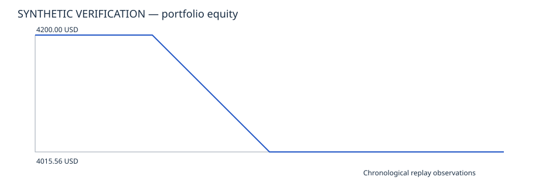
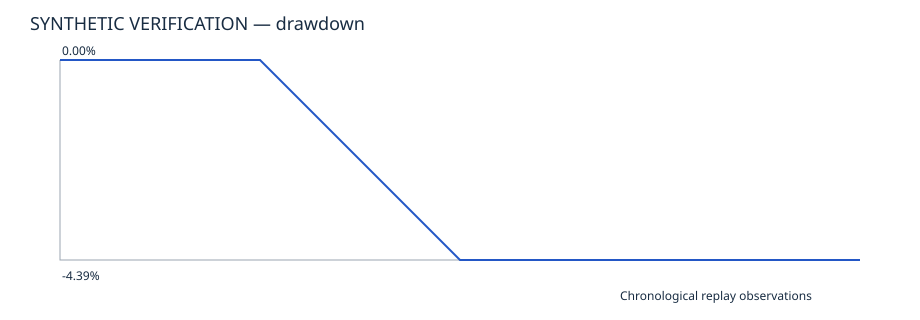
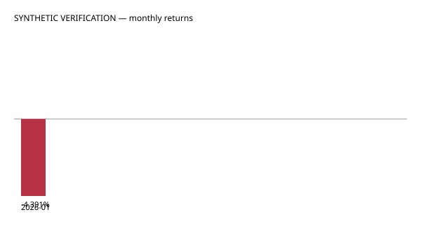

# SYNTHETIC VERIFICATION — performance

**Synthetic fixtures are invented unit-test inputs. They are not historical market observations.**

| Metric | Value |
|---|---:|
| initial capital | 4200 |
| final equity | 4015.560000 |
| net pnl | -184.440000 |
| net return percent | -4.391429 |
| total closed trades | 1 |
| winning trades | 0 |
| losing trades | 1 |
| flat trades | 0 |
| win rate percent | 0.000000 |
| average winning trade | N/A |
| average losing trade | -184.440000 |
| profit factor | 0.000000 |
| max drawdown usd | 184.440000 |
| max drawdown percent | 4.391429 |
| average pnl per trade | -184.440000 |
| expectancy per trade | -184.440000 |
| total commissions | 3.000000 |
| estimated execution costs | 1.440000 |
| sharpe ratio | N/A |
| sharpe observations | 2 |

Portfolio P&L includes marked open positions; trade statistics include closed trades only. Monthly P&L is change in marked portfolio equity, not a sum of exits. Slippage/spread already affect execution prices and are not deducted twice. Open positions are not forcibly liquidated.

252 annualization; zero risk-free rate; last observation of each validated NY session. A verified exchange-session calendar and at least20 session returns are required. Otherwise N/A. Artificial weekend/holiday boundary observations are excluded when a calendar is supplied.

| Month | Trades | Wins | Losses | Net P&L | Return % | Max DD USD | Max DD % |
|---|---:|---:|---:|---:|---:|---:|---:|
| 2026-01 | 1 | 0 | 1 | -184.4400 | -4.3914 | 184.4400 | 4.3914 |
